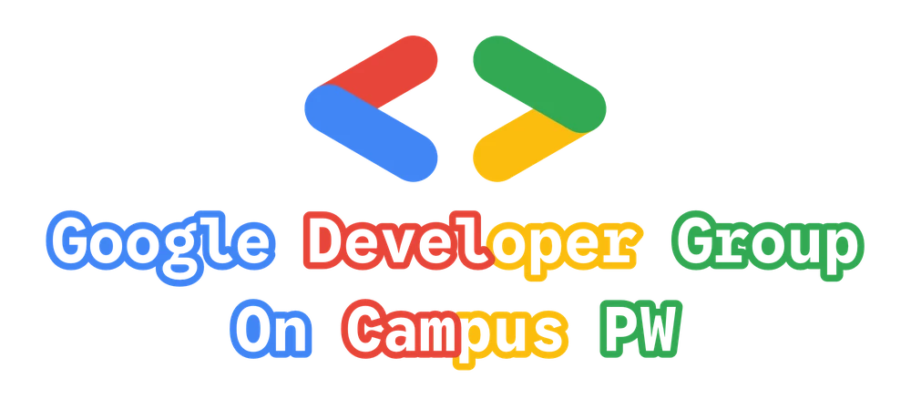
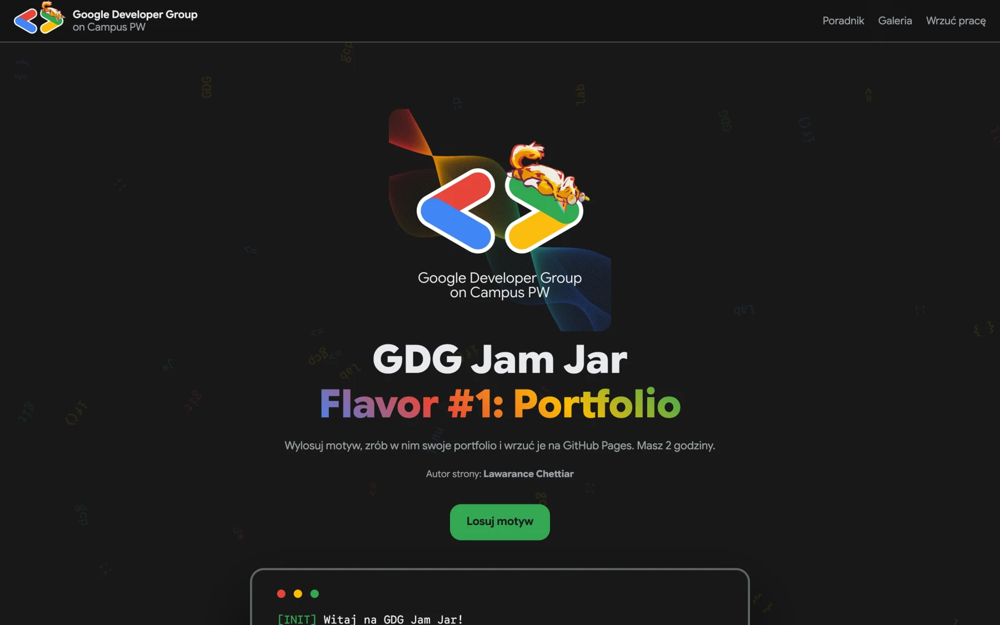
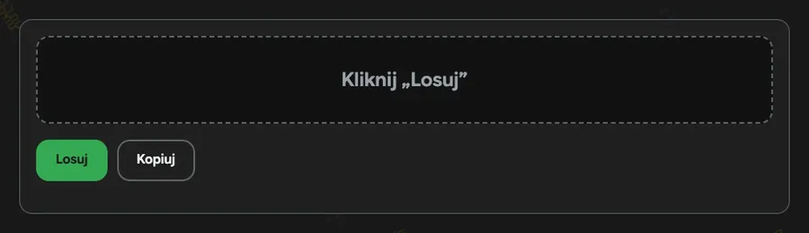
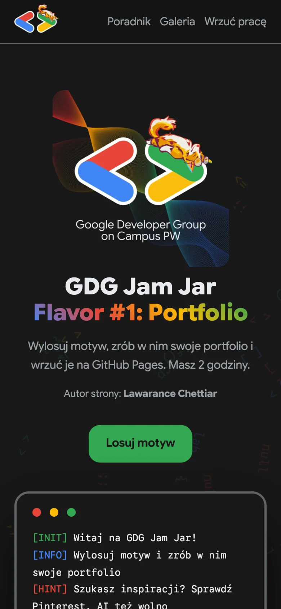
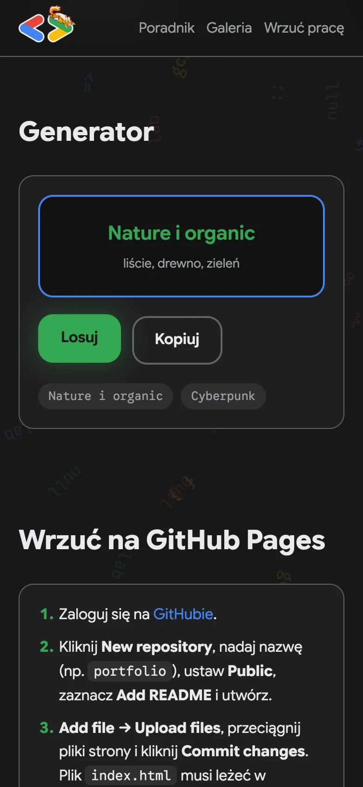
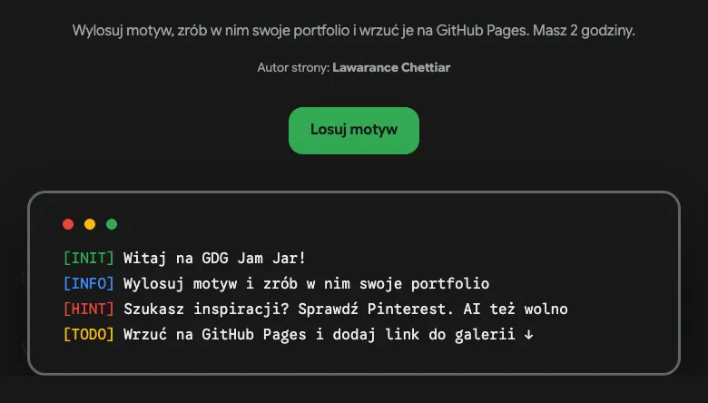

  

  <h1>GDG Jam Jar</h1>
  
Dwie godziny, jeden wylosowany motyw i działająca strona na koniec.

  

    

  
  
  
  
  

---

  

 

**GDG Jam Jar** to seria krótkich spotkań [GDG on Campus PW](https://gdg.community.dev/gdg-on-campus-politechnika-warszawska-warsaw-poland/). Nikt nie prowadzi zajęć krok po kroku: każdy robi swój projekt, podgląda innych i wychodzi z gotową rzeczą. Każda edycja ma swój „flavor”, czyli temat.

---

## 🎲 Flavor #1: Portfolio

  

29 października 2026 · Stara Kotłownia PW

| | |
|--|--|
| 🎲 | Losujesz motyw z 41: od Windows 95 i pixel artu po dark academia |
| 🎨 | Robisz w nim swoje portfolio, sam albo z pomocą AI |
| 🚀 | Wrzucasz je na GitHub Pages według poradnika na stronie |
| 🖼️ | Dodajesz link przez formularz i Twoja praca ląduje w galerii |

---

## 🖼️ Galeria na żywo

Zgłoszenia z Google Forms trafiają do arkusza. Po akceptacji praca pojawia się w galerii na stronie, a strona sprawdza arkusz co minutę, więc na rzutniku nowe prace wskakują bez odświeżania.

---

## 📱 Na telefonie

<table>
  <tr>
    <td align="center"></td>
    <td align="center"></td>
  </tr>
</table>

---

## 🐕 Easter eggi

  

Kliknij duże logo 5 razy albo wpisz `↑ ↑ ↓ ↓ ← → ← → B A`.

---

## Pod maską

- Czysty HTML, CSS i JS. Bez buildów i zależności.
- Motywy, linki i arkusz galerii są w `js/data.js`, a kolory i czcionki w `css/variables.css`.
- Galeria pokazuje zgłoszenia, które ktoś zaakceptował w kolumnie `OK` arkusza. Dane z formularza są escapowane, a przechodzą tylko linki `https://`.
- Lokalnie: `python3 -m http.server` albo `docker compose up --build` i http://localhost:8092.
- Push na `main` to deploy na jamjar.gdgpw.pl w ok. 2 minuty. Portu i montowań w `docker-compose.yml` nie zmieniaj, bo serwer odrzuci taki deploy.

---

  Strona: <a href="https://github.com/lawarance">Lawarance Chettiar</a> &nbsp;·&nbsp; Organizuje <a href="https://gdg.community.dev/gdg-on-campus-politechnika-warszawska-warsaw-poland/">GDG on Campus PW</a> &nbsp;·&nbsp; <a href="https://jamjar.gdgpw.pl">jamjar.gdgpw.pl</a>

